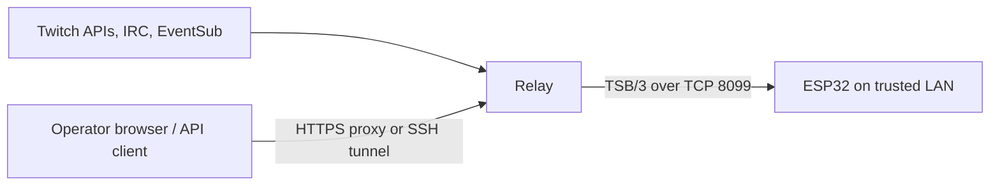

# 🛰️ Run the relay

> Current scope: classic TCP notifications/Twitch, credential-free private HTTP, clock/display/weather/CPU ingress, durable display/monitoring intent and runtime-monitoring APIs are implemented. Default relay DESK negotiation is installed; native application pairing and default ESP32 initialization are tested separately from physical LCD appearance. The admin panel at `/` and canonical snapshot/SSE feed are mounted; complete race/browser/physical acceptance remains pending. The dedicated private HTTPS proxy passes local certificate-verified tests; real mobile consent remains unverified. See [implementation status](../implementation-status.md) and [migration](migration.md).

[Guidebook](../README.md) · [Twitch application setup](twitch-app-setup.md) · [Configuration reference](../reference/relay-configuration.md) · [HTTP API](../reference/http-api.md)

The relay is the always-on middle of your setup: it receives Twitch activity, builds notifications and statistics, and pushes them to the ESP32. Run it on a computer or Linux host that your display can reach over Wi-Fi. Start with Twitch disabled and a manual notification, then simulate activity or connect Twitch once the device path works. Tiny screen, sensible infrastructure. ✨

## Choose your route 🚦

| Route | Best fit | What you install |
|---|---|---|
| [Native development](#native-development-) | Editing or debugging the relay | Git, a Java bootstrap runtime, curl, OpenSSL; Python 3 for the password helper |
| [Docker Compose](#docker-compose-) | An unattended local relay | Git, Docker Engine/Desktop with Compose v2, OpenSSL |
| [Standalone JAR](#standalone-jar-) | An existing JVM service host | Java 25 to run; the repository's Mill wrapper to build |

The [first simulated stream tutorial](first-simulated-stream.md) gives a shorter learning path. This page covers configuration, persistence, and ongoing operation.

## Native development 💻

Start from the repository root:

```sh
cd twitch-screen-relay
export RELAY_TWITCH_MODE=disabled
./mill run
```

The checked-in launcher pins Mill **1.1.9**, Scala **3.9.0**, and Temurin **25** in [build.mill](../../twitch-screen-relay/build.mill). It downloads the pinned toolchain and dependencies on first use, so allow internet access and extra startup time. A current bootstrap Java runtime on `PATH` avoids launcher setup surprises; using JDK 25 directly is the straightforward option.

No management credential is generated or required. Native listeners default to loopback. Anyone reaching HTTP can inspect and control the relay; restrict network access.

Wait for startup logs announcing both listeners:

| Listener | Default | Connects from |
|---|---|---|
| Management HTTP and Swagger | `http://localhost:8080` and `/docs` | Your browser, terminal, and monitoring |
| TSB/3 device TCP | Port `8099` | ESP32 firmware |

In another terminal, confirm the public endpoints:

```sh
curl --fail --silent --show-error http://localhost:8080/api/v1/health
curl --fail --silent --show-error http://localhost:8080/api/v1/stats
```

Health returns `{"status":"Up"}`. Stats contains the latest broadcast state and counters. Public health confirms HTTP liveness; it does not require an attached device or working Twitch authorization.

Check readiness without management credentials:

```sh
curl --fail --silent --show-error http://localhost:8080/api/v1/status
```

Stop the native process with **Ctrl+C**. The relay shuts down its listeners and device sessions; devices reconnect when it returns.

## Keep local configuration private 🔐

The native launcher does **not** automatically read a `.env` file. Use exported variables or explicitly source a private shell file that you created and trust.

From `twitch-screen-relay/`, create a file with private permissions:

```sh
umask 077
touch .env.local
chmod 600 .env.local
```

Edit `.env.local` locally. A non-Twitch configuration needs no secrets:

```sh
RELAY_TWITCH_MODE='disabled'
RELAY_CHAT_NOTIFICATIONS='hide'
```

Load it and run:

```sh
set -a
. ./.env.local
set +a
./mill run
```

Sourcing executes shell syntax; only load a file you control. `.env*` files are ignored except designated example templates. Keep provider/Wi-Fi credentials outside version control, images and screenshots. Never print expanded Compose configuration.

Changing an environment file does not reconfigure a running relay. Startup network/provider configuration requires restarting the owned deployment. `GET /api/v1/config` shows startup configuration with designated secrets masked. Runtime monitoring APIs are mounted: use `GET`/`PATCH /api/v1/twitch/monitoring` for desired/effective source mode and channel. Saved desired display/monitoring intent wins over startup defaults. Selecting ingestion never changes display override or starts a broadcast.

### Authentication migration

Do not configure Basic or Bearer management credentials. Nonempty obsolete `RELAY_HTTP_AUTH_*` settings fail startup. Authorization headers confer no privilege. Remove those settings and restrict network reachability before upgrading; see [migration](migration.md). Twitch OAuth remains separate and still requires provider consent.

## Docker Compose 🐳

From the repository root:

```sh
cd twitch-screen-relay
python3 tools/compose.py --env-file .env.example up --build -d
python3 tools/compose.py --env-file .env.example ps
python3 tools/compose.py --env-file .env.example logs --tail=100 relay
```

The supplied [Compose file](../../twitch-screen-relay/compose.yaml) defaults to **disabled** ingestion, empty channel, hidden chat and loopback-published ports **8080** and **8099**. Management requires no credentials. Use the guarded Compose entry point to reject obsolete settings before interpolation. The checked-in [.env.example](../../twitch-screen-relay/.env.example) contains only safe non-Twitch defaults; do not add private values to it. Explicit `--env-file` avoids accidentally loading an unrelated local `.env`. Exported variables still take precedence, and saved desired settings still win over startup defaults.

The image uses Temurin 25, runs as the unprivileged `relay` user, and stores Twitch authorization under `/home/relay/data`. Compose mounts this directory as the `relay-data` named volume; Docker prefixes its actual name with the Compose project name. Keep the same project name and volume when updating.

The starting container memory limit is **512 MiB**. `JAVA_OPTS` gives the heap up to 70% of container memory and exits on heap exhaustion. This is a starting budget exercised by the repository's container smoke check; measure your own stream/device workload before treating it as a capacity guarantee.

Useful operations, run from `twitch-screen-relay/`:

| Command | Result |
|---|---|
| `docker compose logs --follow relay` | Follow startup and runtime logs |
| `docker compose restart relay` | Restart with the existing container configuration |
| `docker compose up --build -d` | Rebuild and recreate as needed, preserving the named volume |
| `docker compose stop` | Stop containers and retain them and the data volume |
| `docker compose down` | Remove the stack's containers/network; retain its named volume |

Do not add `--volumes` to `down` when you want to retain saved Twitch consent. A plain `restart` does not apply changed environment variables; use `up -d` to recreate the service with its updated configuration.

### Run live Twitch in Compose

The base Compose file interpolates mode/channel/provider settings. No live override YAML is required. First complete [Twitch app registration](twitch-app-setup.md). Create a private `.env.live` in `twitch-screen-relay/` with your actual provider values:

```dotenv
RELAY_TWITCH_MODE=live
RELAY_TWITCH_CHANNEL=yourchannel
RELAY_TWITCH_CLIENT_ID=replace-with-your-client-id
RELAY_TWITCH_CLIENT_SECRET=replace-with-your-client-secret
RELAY_TWITCH_REDIRECT_URL=http://localhost:8080/api/v1/twitch/callback
RELAY_CHAT_NOTIFICATIONS=hide
```

Then use the guarded entry point:

```sh
chmod 600 .env.live
python3 tools/compose.py --env-file .env.live up --build -d
python3 tools/compose.py --env-file .env.live logs --tail=100 relay
```

Use the same env-file and project name for future updates. Exported shell variables can override interpolation-file values. Do not share expanded configuration or provider secrets. Complete provider consent using the [Twitch application guide](twitch-app-setup.md). No relay management login is required. This setup does not start a broadcast or certify live acceptance.

### Weather dashboard

Use the [backend weather guide](weather.md) to enable optional Open-Meteo collection, configure location and units, and select the Weather base screen. Provider fetching and Twitch ingestion are independent; admin Display intent controls the device's base widget through DESK/1. The device opens the usual TCP connection and receives pushed snapshots. Classic-only older firmware cannot apply dashboard choices.

### Persistence and backups

The Twitch token file and separate `RELAY_RUNTIME_STATE_FILE` (default `data/runtime-state.json`) persist. The latter stores desired display and monitoring settings, not credentials. Replay history, telemetry, sequence state, logs, alerts and activity are memory-resident and reset with the process. Back up both persistent stores privately; this does not create a durable event archive.

Stop the relay before a token-volume backup, use your normal encrypted backup tooling, and protect restoration access as you would a password. Named volumes inherit the image's data-directory ownership. When choosing a bind mount instead, the directory must be writable by UID **10001**, the container's relay user.

## Standalone JAR 📦

Build from `twitch-screen-relay/`:

```sh
./mill assembly
```

Run the generated artifact with Java 25 and your exported configuration:

```sh
java -jar out/assembly.dest/out.jar
```

The token path remains relative to the process working directory. For an OS-managed service, choose a stable working directory, load secrets from a restricted environment file, restart on failure, and preserve the token directory across deployments. The repository does not ship a systemd unit or an automatic release installer.

## Network boundaries and HTTPS 🔒

The two listeners serve different audiences:



The ESP32 initiates the device connection; the arrow above shows the direction of pushed data. Set firmware `SERVER_HOST` to the relay's **LAN IP or resolvable hostname**, and `SERVER_PORT` to `8099`. `localhost` on the ESP32 refers to the ESP32, not your computer. Reserve the relay's LAN address in your router so a DHCP change does not strand the display.

The device TCP listener has **no authentication or TLS**. Keep port 8099 on a trusted LAN/VPN, with firewall access limited to the device network. Never expose either listener to the internet. HTTP management is also credential-free.

### Explicit private device access

Both native listeners and Compose port publication default to loopback. For a physical device, choose the relay host's actual trusted interface address; do not use wildcard publication. For example, replace `192.168.1.10` with that address and restrict your firewall before starting:

```sh
export RELAY_BIND_IP=192.168.1.10
export RELAY_HTTP_ALLOWED_HOSTS='localhost:8080,127.0.0.1:8080,192.168.1.10:8080'
export RELAY_HTTP_ALLOWED_ORIGINS='http://localhost:8080,http://127.0.0.1:8080,http://192.168.1.10:8080'
python3 tools/compose.py up --build -d
```

`RELAY_BIND_IP` controls host publication only; container listeners remain on `0.0.0.0`. Native operation instead uses explicit `RELAY_DEVICE_HOST` and, only if remote HTTP is needed, `RELAY_HTTP_HOST`. Configure exact HTTP authorities/origins including ports. These checks resist hostile browser origins; they are not peer authentication. Native/CLI clients reachable on the trusted network need no Authorization header.

The HTTP server speaks plain HTTP. For browser-trusted private HTTPS, follow the [dedicated Caddy topology](../../twitch-screen-relay/deploy/private-https/README.md). Bridged Docker upstreams require the exact Caddy container hop, not a blanket loopback trust assumption. Trust forwarded headers only from the configured immediate proxy. Preserve Host and provider callback paths; OAuth state and EventSub signatures remain required. Do not proxy public wildcard management routes.

Remote mobile OAuth requires a resolvable private hostname, consenting client CA trust and the exact registered HTTPS callback. Those physical/mobile gates remain pending. Without that setup, use desktop-local or SSH-tunneled loopback consent; plain HTTP LAN callbacks are not supported.

Health, stats, diagnostics and Swagger require no login. Keep all of them inside the network boundary. The bundled admin panel opens at `/`; its canonical snapshot and SSE feed use the same private origin. Firmware reports are observations, not proof of pixels.

## Observe, update, recover 🧰

Use `/api/v1/status` without credentials for Twitch health, connected-device counts, dropped internal-bus events, and buffer/alert counts. `/api/v1/devices` adds per-connection traffic counters; `/api/v1/logs` and `/api/v1/activity` help explain what happened. The [API reference](../reference/http-api.md) includes filters and sample requests.

OpenTelemetry exports are disabled unless configured. To send traces and metrics to an existing collector, from `twitch-screen-relay/`:

```sh
OTEL_TRACES_EXPORTER=otlp OTEL_METRICS_EXPORTER=otlp \
OTEL_EXPORTER_OTLP_ENDPOINT=http://collector:4317 ./mill run
```

Replace `collector` with a reachable collector hostname. Container deployments must explicitly forward these variables in their Compose environment. No collector, Grafana instance, or Prometheus endpoint is installed by this command.

For an update, stop the old process, retain configuration and token storage, build the selected revision, and start with the same environment. Check health, credential-free readiness, and a manual device notification afterward. Devices and relay must both speak **TSB/3**; older NDJSON firmware cannot connect to this relay. Missed notifications are eligible for replay only while retained by the current process: 64 non-chat records by default, plus a separate 16-record chat ring.

For a problem report, include the commit, runtime/OS, selected mode, redacted status, relevant logs, and whether a manual notification arrives. Leave out the environment file, authorization headers, and token JSON. Follow the [troubleshooting guide](troubleshooting.md) for symptoms and the [firmware setup guide](firmware-setup.md) for the other half of the connection.

Source trail: [Compose deployment](../../twitch-screen-relay/compose.yaml), [container image](../../twitch-screen-relay/Dockerfile), [configuration](../../twitch-screen-relay/resources/application.conf), [management authentication](../../twitch-screen-relay/src/twitchscreen/relay/http/ManagementAuth.scala), and [container smoke check](../../tools/smoke_container.py).
