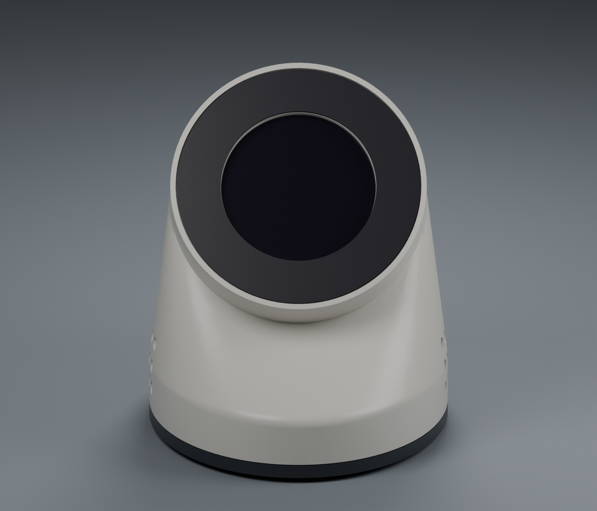

<div align="center">

<h1>⚡ Twitch Screen · Firmware</h1>

<p><strong>240 × 240 pixels. A surprising amount of personality.</strong></p>
<p>ESP32 · Arduino · TFT_eSPI · LVGL 9 · TSB/3</p>

<p>
  <a href="../docs/guides/firmware-setup.md">Flash your device</a> ·
  <a href="../docs/guides/device-build.md">Wiring & build</a> ·
  <a href="../docs/guides/device-use.md">Daily use</a> ·
  <a href="../docs/README.md">Guidebook</a>
</p>



<p><em>CAD visualization of the enclosure; physical fit remains to be validated.</em></p>

</div>

This firmware turns a classic ESP32 DevKit V1 and Waveshare GC9A01 LCD into an always-on stream dashboard. The [relay](../twitch-screen-relay/README.md) sends telemetry and notifications over persistent TCP; the device handles its own presentation, queue and reconnect loop. Your desk gets a tiny hype department. 💜

## ✨ What runs on the screen

- A self-contained **Generic** Picsum/Kyiv-weather screensaver with five-second slides, independent of the relay; see [connectivity, public services and WROOM limits](../docs/guides/standalone-generic.md).
- Colorful instrument-style **Weather** and **CPU** dashboards, selectable through the relay admin; see [widget visuals and gauge meanings](../docs/guides/widgets.md).
- Red-yellow breathing gas when Wi-Fi/internet is unavailable, with distinct connectivity messages, plus linked **OFFLINE** and **LIVE** Twitch states.
- Viewer count, stream uptime, follower/subscriber totals and observed chat total.
- A chat-activity ring and event cards for follows, subs, gifts, raids, Bits, chat and stream transitions.
- Automatic retries and bounded replay after connection interruptions.
- Custom INFO, MESSAGE, WARNING and ALERT cards supplied by the relay.

The current build has no touch/menu input, on-device provisioning, PWM brightness setting or OTA updater. Wi-Fi and relay settings are compiled in; USB is the update path. [Daily use](../docs/guides/device-use.md) explains timing, ASCII text support and recovery limits.

## DESK implementation status

The host-tested DESK controller, conservative clock model, additive codecs and
bounded report-intent scheduler are implemented as firmware modules. All 23 additive
canonical vectors are exercised alongside unchanged classic suites. The actual TCP
session has opt-in DESK dispatch and atomic reports. Main uses one controller for
classic cards and actual LVGL lifecycle callbacks; a memory-display LVGL test exercises
those callbacks under ASan/UBSan. The shared application greeting binding preserves
negotiated DESK sessions while retaining classic baseline/resume behavior. Main now
binds controller-selected Twitch and Generic bases through a rendering-only adapter;
notifications cover the entire base rather than only Twitch. First boot renders the
local Generic connectivity animation before networking. Generic uses bounded runtime
photo buffers and direct public weather; Weather/CPU views use fixed objects and
bounded text, with honest optional-field handling. Actual Receiver codecs and
LVGL animations test staged readiness, override hiding and freshness before and during
slide-out. The default ESP32 enables `CAP_DESK_V1` only after all base widgets,
notification lifecycle bindings and a nonzero immutable per-boot identity are ready.
Session readiness still requires calibrated coherent synchronization. Complete joint
profile acceptance, physical layouts/resources and the broader product gates remain
separate from that capability. Actual frozen default Main/Compose assemblies have
passed native capable/API pairing; that is not physical pixel acceptance.
Telemetry software precursors do not establish whole D2/E2 acceptance. DESK STATS
revision floors remain connection-scoped across source changes. Unknown/unavailable
Twitch measurements render `--`, distinct from observed zero; a source-switch control
invalidates prior-source values before the next render or card reveal. Actual LinkSession
and LVGL memory-display regressions cover these paths without claiming physical pixels.
See [controller boundaries and verification](docs/desk-controller.md) for interfaces,
test commands and the required integration order. Host tests are not LCD evidence.
An explicitly invoked [actual TCP application peer](docs/runtime-pairing.md) now
pairs LinkSession/Controller/Receiver and real LVGL callbacks with a current-source
Scala relay. Classic reconnect/replay and ten-card pressure across eight pending
slots pass. `--require-desk` makes real capable synchronization, complete socket-written
reports and two ordered generic lifecycles mandatory; classic fallback then fails the
combined command. Exact frozen production Main/Compose artifacts pass this native
software gate; complete profile acceptance and physical visual validation remain pending. A separate
synthetic socket test verifies the executable's observation and short-write paths;
synthetic traffic is not capable-relay or physical acceptance. A separate actual
application recovery regression retains eight cards across a synthetic TCP reconnect,
verifies zero-credit control/CPU expiry and completes their real LVGL lifecycles.
Per-connection readiness, actual adapter visibility and complete report control/base
fields are recorded; no report or ACK is presented as physical rendering evidence.
Focused [writer and continuous-control gates](docs/runtime-pairing.md#actual-kernel-writer-and-continuous-control)
now exercise real kernel backpressure on the Linux firmware socket and installed
capable relay session, plus 121 override/source/episode changes beneath a long
active generic card. Every report/view and sampled remotely accepted control are
checked. These focused software tests do not enable the default ESP32 profile,
certify complete provider/source teardown or replace physical LCD/soak acceptance.
A separate [default Main process-restart gate](docs/runtime-pairing.md#default-production-process-restart-recovery)
now proves persisted intent, fresh-epoch cursor/credit reset, retained original
card identities, waiting expiry and actual LVGL completion through a test-owned
relay outage. Application observations include both epoch and connection ID;
connection IDs may repeat after restart. Missing RAM telemetry stays hidden at
every reveal. This is not a suspend/provider, Docker-restart or board claim.
A separate [actual process-suspension gate](docs/runtime-pairing.md#default-production-process-suspension-recovery)
stops only its owned native child for over sixty seconds against frozen Main.
It verifies receiver-gap invalidation before resumed views, original waiting expiry,
current source/control fences, conserved reconnect credit and full active/offline
card completion. This is not machine suspend, live provider or default ESP32 proof;
physical/network/soak acceptance and complete-profile advertisement stay gated.

## 🚀 Quick start

From the **repository root**, install the pinned CLI and create the private header without replacing an existing one:

```sh
python3 -m venv .venv-pio
.venv-pio/bin/python -m pip install platformio==6.1.18
cd twitch-screen-firmware
if [ ! -e src/credentials.h ]; then
  cp src/credentials.example.h src/credentials.h
fi
```

Edit `src/credentials.h`: enter your Wi-Fi credentials, the relay computer's **LAN address**, TCP port `8099`, and optionally a unique device name. Leave `DEVICE_ID` empty for an automatic chip-derived identity. Do not commit this header or share a firmware binary containing your private settings.

The Wi-Fi password is recoverable from the firmware image/flash: this build does not enable flash encryption or secure boot. Use a trusted home network and physical device access; changing provisioning/security requires a separate migration with device recovery planning. HELLO identity/version control and non-ASCII bytes are replaced with `_` before transmission. The device TCP link is plaintext and unauthenticated; see the [protocol threat model](docs/PROTOCOL.md#2-transport-and-endianness).

Run these commands sequentially from `twitch-screen-firmware/`:

```sh
../.venv-pio/bin/pio test -e native
../.venv-pio/bin/pio run -e esp32dev
```

On Linux, also run the sanitizer gate:

```sh
../.venv-pio/bin/pio test -e native-sanitized
../.venv-pio/bin/pio test -e native-lvgl
../.venv-pio/bin/pio test -e native-lvgl-base
../.venv-pio/bin/pio test -e native-generic
```

Once the correct device is connected, upload and inspect it:

```sh
../.venv-pio/bin/pio run -e esp32dev -t upload
../.venv-pio/bin/pio device monitor
```

The monitor uses 115200 baud. Close it before another upload. For explicit port selection, OS setup and BOOT-button recovery, use the complete [firmware setup guide](../docs/guides/firmware-setup.md).

For relay-backed simulated stats/cards, start the [LAN-reachable simulated relay](../docs/guides/firmware-setup.md#start-a-relay-the-physical-device-can-reach) before boot and leave it running. Standalone Generic can instead fetch public photos/weather with Wi-Fi/internet and no relay. The [first simulated stream tutorial](../docs/guides/first-simulated-stream.md) is a separate local exercise whose loopback-only listener cannot accept a physical ESP32. Management APIs require no application credentials; trusted private-network isolation plus Host/Origin defenses define the boundary. Twitch OAuth remains separate. The old Python/NDJSON demo is incompatible with TSB/3.

## 🔌 Wiring

Disconnect power before changing connections.

| LCD | ESP32 label | GPIO |
| --- | --- | --- |
| VCC | 3V3 | — |
| GND | GND | — |
| DIN | D23 | 23 |
| CLK | D18 | 18 |
| CS | D5 | 5 |
| DC | RX2 | 16 |
| RST | D4 | 4 |
| BL | D15 | 15 |

The authoritative configuration is in [platformio.ini](platformio.ini): GC9A01, 240 × 240, 40 MHz SPI, `huge_app.csv`, pinned libraries and compiler flags. TFT_eSPI receives its setup through those flags; there is no library `User_Setup.h` to edit.

## 🧭 Source map

| File | Responsibility |
| --- | --- |
| [main.cpp](src/main.cpp) | Arduino setup/loop, queue admission and display dispatch |
| [link_client.cpp](src/link_client.cpp) | Transport-independent TSB/3 session, deadlines and retry state |
| [link_transport_esp32.cpp](src/link_transport_esp32.cpp) | ESP32 Wi-Fi, DNS and nonblocking TCP integration |
| [proto_codec.cpp](src/proto_codec.cpp) | Bounded binary encoder, decoder and stream framing |
| [notify_queue.h](src/notify_queue.h) | Eight-entry waiting queue, replay position and admission policy |
| [notification_wire.h](src/notification_wire.h) | Protocol fields converted into display notifications |
| [lv_port.cpp](src/lv_port.cpp) | LVGL/TFT bridge; one 19,200-byte synchronous partial draw buffer |
| [ui_idle.cpp](src/ui_idle.cpp) / [ui_notify.cpp](src/ui_notify.cpp) | Dashboard states and notification cards |
| [presentation.h](src/presentation.h) | Compact counts and readable chat colors |
| [include/lv_conf.h](include/lv_conf.h) | Project LVGL configuration |
| [test/](test/) | Host codec, queue, session, presentation and parser regressions |
| [tools/build_version.py](tools/build_version.py) | Source commit identifier embedded in the device greeting |

LVGL and application callbacks remain on the Arduino loop. Network work must keep that loop responsive. When the queue is full, event consumption pauses; defensive refusal reconnects before a later sequence can cross the gap. ACK reports queue admission, not completed on-screen presentation.

## 🧪 Verification and limits

The DESK software precursors are described in [desk-controller.md](docs/desk-controller.md).
Negotiated generic cards reuse the existing widgets with compact metadata and a
wrapped, ellipsized body, or a multiline headline when bodyless. Classic cards keep
their original layout, including after retained cards cross a reconnect. Layout
choice never determines notification provenance or admission policy.

Boot setup supplies a nonzero, ephemeral 64-bit correlation identity once before
network initialization. Reconnect and classic fallback do not replace it. This is
not a credential or a guarantee of uniqueness. The production receiver still has
`profileReady=false`: a boot identity does not enable `CAP_DESK_V1`. The default
ESP32 profile and complete joint profile acceptance remain pending;
verified native production pairing does not close those gates.

From the repository root:

```sh
python3 tools/check_protocol_vectors.py
python3 twitch-screen-firmware/tools/test_pairing_runbook.py
.venv-pio/bin/python twitch-screen-firmware/tools/test_runner_contract.py
```

This checks the shared normative protocol vectors. Native tests and an ESP32 compile establish software results; they do not establish physical LCD rendering, Wi-Fi outage recovery or watchdog behavior on hardware. Record those observations separately after any upload.

Every minute, bounded [runtime measurements](docs/runtime-measurements.md) report cumulative loop/UI timing upper bounds and sampled heap/block/stack minima. Native tests verify the measurement arithmetic, not physical performance or continuous allocator minima.

Boot logs report watchdog initialization/subscription status and the configured 10-second timeout. Every minute the loop reports its minimum free stack in bytes. Exercise live cards, long text, replay bursts and reconnects before recording hardware headroom; no measured minimum is asserted by host tests. LVGL allocation/assertion failures halt rendering with a repeated serial diagnostic while keeping the idle task/watchdog fed, avoiding an allocation-triggered reboot loop. UART diagnostics are dropped when the output buffer is full so replay cannot block the display loop.

Replay cards appear immediately without entrance effects. Routine live cards slide once; WARNING/ALERT retain the attention flash. Hidden dashboard timers and animations pause until visible again. Full-queue input pauses end after twice the relay's advertised idle timeout (180 seconds for the default 90-second idle), then reconnect for replay without advancing the queue sequence.

PlatformIO commands share a package store: do not run installs/builds concurrently. If an old global virtual environment stops importing PlatformIO after a Python update, use the isolated setup above.

## 📚 Keep exploring

- [TSB/3 specification](docs/PROTOCOL.md) — the normative wire contract and finite replay guarantees.
- [Hardware build guide](../docs/guides/device-build.md) — parts, printing, wiring and assembly.
- [Troubleshooting](../docs/guides/troubleshooting.md) — display colors, upload failures and connection logs.
- [Relay setup](../docs/guides/relay-setup.md) and [Twitch application setup](../docs/guides/twitch-app-setup.md).
- [PLAN.md](../docs/reference/desk-contract.md) — historical design notes and roadmap; some earlier status entries predate the current relay and enclosure.
- [Project overview](../README.md).
