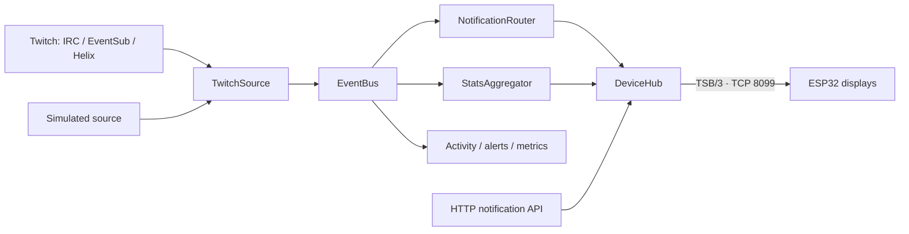

<div align="center">

# 🛰️ twitch-screen-relay

**Your stream's backstage crew. Your tiny screen's very chatty friend.**

Twitch activity → Scala relay → TSB/3 → ESP32 desk display ✨

[🏠 Project overview](../README.md) · [📚 Guidebook](../docs/README.md) · [🎮 Connect Twitch](../docs/guides/twitch-app-setup.md) · [🔌 HTTP API](../docs/reference/http-api.md)

</div>

The relay watches a Twitch channel, turns activity into notification cards and live stats, and pushes them to ESP32 displays over persistent TCP. It also provides a credential-free private management API, a simulator, diagnostics, and Swagger UI.

Built with **Scala 3**, **Ox**, synchronous **Tapir/Netty**, **jsoniter-scala**, **PureConfig**, **MacWire**, and **Twitch4J**. Versions are pinned in [build.mill](build.mill); the stack follows the [VirtusLab Scala Stack](https://vss.virtuslab.com/) approach.

## DESK implementation status

The actual hub/session installs a bounded DESK owner. Relay now negotiates the complete profile by default only when HELLO supplies the capability and valid profile tail; classic peers retain their legacy path. Current native application tests cover synchronization, credit, reconnect pressure, explicit epoch reset and actual blocked-writer/continuous-control scenarios. Final assembled Main and the actual isolated Compose path pass native capable synchronization, reconnect and queue-pressure pairing. Full old/new peer-matrix acceptance and firmware default advertisement remain pending. See [actual session pairing](docs/desk-session-pairing.md) and [delivery boundary](docs/desk-delivery.md); test fixtures are not physical acceptance.

The settings owner is installed at startup. `RELAY_RUNTIME_STATE_FILE` defaults to `data/runtime-state.json`; persisted monitoring intent overrides first-run source defaults. Existing storage must have a private 0700 parent and 0600 file. Corrupt or unsafe state stops startup without replacement. Durable display GET/PATCH, runtime monitoring GET/PATCH and externally supplied CPU/weather GET/PUT are mounted. Telemetry writes do not select a dashboard or consume notification sequences. Monitoring resolves live logins before durable acceptance and applies source replacement asynchronously; see [runtime monitoring](docs/runtime-monitoring.md). Complete live-provider/source failure acceptance and default negotiated device delivery remain pending.

Weather accepts one latest external source at `/api/v1/weather`, with Celsius default, explicit Fahrenheit, optional humidity and bounded monotonic freshness. `/api/v1/display` reports its current readiness even under Twitch override. No provider collector or telemetry history is created. See [weather ingress](docs/weather-ingress.md) for validation, calibrated deadlines and acceptance limits.

The production hub installs a [reliable admin observation owner](docs/admin-observation.md): atomic register/capture, bounded latest-only replacement, accepted-report and writer-lane refresh independent of the lossy bus, deadline-driven freshness transitions, and bounded fifteen-minute disconnect history. Canonical `/api/v1/admin/snapshot`, `/api/v1/admin/events` and the bundled panel at `/` are mounted. Firmware FIFO/application is unknown without calibrated report authority; transport pressure and relay history are separate. Complete race/reset/producer-to-panel and accessibility acceptance remains pending; software observations are not physical pixels.

## 🚀 First run: no Twitch account required

Have a Linux/macOS-style shell, Git, curl, OpenSSL, and **JDK 25 on `PATH`** ready. Mill's JVM launcher needs an installed Java runtime before it can download the pinned toolchain on platforms that cannot use its native launcher. See [native relay setup](../docs/guides/relay-setup.md#native-development-) for prerequisites and configuration.

From this directory:

```sh
RELAY_TWITCH_MODE=simulated ./mill run
```

The launcher downloads the pinned Mill **1.1.9** and Temurin **25** toolchain on first use. Management needs no login. Native HTTP and device listeners bind loopback by default.

Open **`http://localhost:8080/docs`** for Swagger UI. Check liveness:

```sh
curl --fail --silent --show-error http://localhost:8080/api/v1/health
```

Expected: `{"status":"Up"}`. The simulator produces a repeating stream of events, even with no device attached. For a physical display, explicitly bind `RELAY_DEVICE_HOST` to a trusted LAN/VPN interface, then set firmware `SERVER_HOST` to that address and `SERVER_PORT` to **8099**. Compose uses `RELAY_BIND_IP` for the published interface.

Send your first card from a terminal:

```sh
curl --fail --silent --show-error \
  -H 'Content-Type: application/json' \
  --data '{"type":"info","title":"Hello, tiny world","body":"The desk lore begins."}' \
  http://localhost:8080/api/v1/notifications
```

Want the guided version? Start with [your first simulated stream](../docs/guides/first-simulated-stream.md), then [run the relay](../docs/guides/relay-setup.md).

## 🎛️ Pick a mode

| Mode | What happens | Twitch credentials |
|---|---|---|
| `disabled` | Manual API notifications and device services | None |
| `simulated` | Synthetic follows, subs, gifts, raids, Bits, chat, totals, and an initial stream-start event | None |
| `live` | Real Twitch Helix, IRC, and EventSub integration | Client ID/secret, then broadcaster consent |

The native default is `disabled`; the supplied Compose file also uses `disabled`. Chat cards default to **hidden** so follows and raids can have their moment. Accepted chat still contributes to counters.

## 🎮 Connect your channel

Use the [complete Twitch setup guide](../docs/guides/twitch-app-setup.md) to register a **Confidential** app, set the exact callback, configure live mode, and grant consent as the broadcaster. The relay resolves the broadcaster's numeric ID from the channel login.

The default callback is `http://localhost:8080/api/v1/twitch/callback`. Start consent at the private `/api/v1/twitch/authorize`; open it from the configured same-origin browser. Tokens are saved in `data/twitch-token.json`, refreshed before expiry, and validated periodically. With valid application/OAuth configuration, consent and grant ownership now remain available in disabled and simulated ingestion modes too. Missing configuration leaves those routes unavailable without blocking generic operation. Runtime channel mutation and scheduled source recovery are installed; complete provider/device acceptance remains pending. See [runtime monitoring](docs/runtime-monitoring.md) and [runtime ownership](docs/runtime-ownership.md). The ESP32 never stores Twitch credentials.

Default EventSub delivery uses an outbound **WebSocket**, which suits a home LAN. Webhooks are also supported with a public HTTPS callback. Live event sources are deliberately split:

| Source | Responsibility |
|---|---|
| Anonymous IRC | Chat, subscriptions, gifts, Bits, raids |
| EventSub | Follows, stream online/offline, channel updates |
| Helix polling | Viewer, follower, and subscriber totals |

Default scopes are `moderator:read:followers` and `channel:read:subscriptions`. IRC event types are not backed up by EventSub subscriptions in this version. Real-account provider acceptance and sustained recovery still require validation with actual Twitch credentials.

## 🧠 How it fits together



`DeviceHub` serializes sequence allocation and retains two bounded replay rings: **64 non-chat notifications** by default and **16 chat notifications**. A reconnect can replay retained events; relay restarts reset that history. TSB/3 provides best-effort replay, not durable delivery.

Internal consumers have bounded queues so slow diagnostics cannot stall Twitch ingestion. Per-device backpressure protects event ordering: a failed event enqueue closes the affected connection before later events can pass it; stats frames may be dropped. Device sessions and workers live inside the application lifetime managed by Ox.

The binary [TSB/3 specification](../twitch-screen-firmware/docs/PROTOCOL.md) defines the shared contract. NDJSON v2 peers cannot connect. Device TCP trusts the LAN and has **no authentication or TLS**; keep it private.

## 🐳 Docker, persistence, and configuration

From this directory, without management credentials:

```sh
python3 tools/compose.py up --build -d
python3 tools/compose.py logs --tail=100 relay
```

Compose publishes ports **8080** and **8099** on loopback, starts disabled mode, sets a **512 MiB** starting memory budget, and persists the token directory in a named volume. See [relay deployment](../docs/guides/relay-setup.md) for live-mode overrides, private environment files, backups, HTTPS, and headless consent.

Common settings:

| Variable | Default | Purpose |
|---|---|---|
| `RELAY_HTTP_ALLOWED_HOSTS` | Loopback authorities on `8080` | Exact Host allowlist, comma-separated |
| `RELAY_HTTP_ALLOWED_ORIGINS` | Loopback HTTP origins on `8080` | Exact browser-origin allowlist, comma-separated |
| `RELAY_BIND_IP` | `127.0.0.1` | Compose publish interface |
| `RELAY_HTTP_PORT` | `8080` | Management listener |
| `RELAY_DEVICE_PORT` | `8099` | ESP32 TCP listener |
| `RELAY_TWITCH_MODE` | `disabled` | Select source |
| `RELAY_CHAT_NOTIFICATIONS` | `hide` | Show/hide individual chat cards |
| `RELAY_NOTIFICATION_TTL` | `8 seconds` | Default duration for manually posted cards |
| `RELAY_STATS_INTERVAL` | `5 seconds` | Device dashboard push cadence |

The [complete configuration reference](../docs/reference/relay-configuration.md) distinguishes environment overrides from advanced HOCON settings. Config is read at startup; private `GET /api/v1/config` shows effective values with secrets masked. OpenTelemetry exports are opt-in through standard `OTEL_*` variables.

## 🔌 Your control room

| Endpoint | Use |
|---|---|
| `GET /api/v1/health` | Public HTTP liveness |
| `GET /api/v1/stats` | Public aggregate stats |
| `GET /api/v1/status` | Private integration/device readiness |
| `GET /api/v1/devices` | Device identities and traffic diagnostics |
| `GET /api/v1/clock` | Non-cacheable relay monotonic calibration sample |
| `GET`, `PATCH /api/v1/display` | Durable desired display control and independent CPU/weather readiness |
| `GET`, `PUT /api/v1/cpu` | Latest independently revisioned CPU sample with calibrated freshness |
| `GET`, `PUT /api/v1/weather` | Latest weather sample; external producers supply data |
| `GET`, `PATCH /api/v1/twitch/monitoring` | Desired/effective runtime source and channel; separate from display and OAuth |
| `GET /api/v1/admin/snapshot`, `/api/v1/admin/events` | Bounded canonical observations and same-origin coalesced SSE |
| `GET /` | Bundled private-network admin panel; no login or CDN |
| `GET`, `POST /api/v1/notifications` | Original publication history and calibrated card admission |
| `GET /api/v1/activity`, `/alerts`, `/logs` | Recent activity and operational diagnostics |

Swagger is at `/docs`. The [HTTP API reference](../docs/reference/http-api.md) describes legacy routes and filters; this component table and Swagger describe the newly mounted display/clock/CPU/calibrated-notification routes. Canonical notification types include `stream_start` and `stream_end`; unseparated aliases are rejected. Notification POST returns **200**; retries can publish duplicates. Ordinary relay ingress is bounded to 64 KiB; companion outbound requests and persisted state have separate 16 KiB ceilings. Notification hold defaults to 8000 ms and accepts 100–30000 ms rounded up to 100 ms; useful lifetime independently defaults to 60000 ms and accepts 1–600000 ms. Optional `deadline` carries the nonzero fixed-width hexadecimal `relayEpoch` and JSON-safe `monotonicMs` from calibration. Responses include original provenance/fences, nominal `expiresInMs` and nonrenewing `remainingExpiryMs`. Wrong epoch is 409, expired is 410 and global 10/s burst-20 overflow is 429 with `Retry-After: 1`. CPU uses its own global 10/s burst-20 bucket and independent u32 revision. Host labels accept up to 128 valid Unicode scalars. Exact integral decimal/exponent JSON numbers are accepted without coercion. Successful CPU/card writes carry actor-owned `X-Relay-Epoch` and `X-Relay-Monotonic-Ms` samples tied to the accepted epoch. Explicit request nulls, unknown/duplicate keys and invalid ranges fail before mutation; missing optional CPU response fields are explicit nulls. Classic receivers still cannot enforce useful-life expiry after transmission. Shared discontinuity reset is installed; complete suspend/provider/failure acceptance remains pending.

Use an SSH tunnel for management requests across networks. Exact trusted immediate-proxy/public-origin validation now supports private HTTPS termination; see the [digest-pinned Caddy example](deploy/private-https/README.md). Untrusted, ambiguous or chained forwarding headers are rejected. Real mobile CA trust/consent remains pending; certificate-verified test-owned Compose SSE/panel proxy checks pass their exercised software subset. Management has no application authentication. Never expose either listener to the internet. Configure exact allowed authorities/origins when changing ports or binding a trusted LAN/VPN interface. Browser requests must match an allowed same-origin Origin; cross-site Fetch Metadata is rejected. Mutations require application/json. Callback exemptions do not bypass Host or provider verification. Nonempty obsolete RELAY_HTTP_AUTH_* or http.auth settings fail native startup with key-only migration guidance. Use `python3 tools/compose.py --env-file PATH up --build -d` for Compose deployments: its preflight checks the complete interpolation environment and rendered service environment, including arbitrary obsolete prefix keys, without printing values. Direct `docker compose` also forwards the three former token/Basic variables solely for startup rejection, but cannot enumerate arbitrary prefix keys; do not bypass the guarded entry point for migration. Empty obsolete values are permitted and never enable authentication. Root guidebook and smoke-tool migration remain integrator work; this component quickstart is authoritative for the new boundary.

HTTP mutation bodies now pass a bounded completion fence before Tapir receives any request: valid JSON prefixes with incomplete Content-Length/chunked framing never dispatch after timeout, EOF or body-limit closure. Fully framed requests retain normal typed decoding and keep-alive behavior. The HTTPS Compose overlay uses a dedicated network and exact Caddy container IP, not host loopback trust. `python3 tools/smoke_private_https.py` exercises certificate-verified HTTPS against the current relay with test-owned CA/ports and verifies notification readback, hostile Origins/Hosts, direct forwarding spoof rejection and owned cleanup. It does not install host trust or prove mobile consent.

## DESK/1 implementation status

The relay installs DESK/1 alongside the unchanged classic TSB/3 path. Capable sessions use the coherent six-frame greeting, calibrated absolute deadlines, independent processed/enqueued cursors, cumulative report credits and prioritized control/snapshot delivery. Classic peers retain their documented fallback and cannot enforce waiting expiry after transmission. Display, weather, CPU, monitoring, snapshot/SSE and the bundled panel are mounted in the production assembly. Runtime settings persist display and monitoring intent separately from the stable OAuth owner; source switches install generation fences without restarting HTTP/device listeners. Discontinuity recovery resets the epoch and stale RAM data while retaining desired settings.

Actual Main/Compose and native application checks exercise synchronization, reconnect, queue pressure, original freshness and report/queue observations. Canonical snapshots and SSE join monitoring in settings acceptance order; stale coalesced wakes cannot combine an old channel capture with newer intent. The panel marks retained source/chart observations not current on feed/browser loss and reconnects without periodic API polling or automatic notification POST retries. It also ages source freshness and report observations locally when an otherwise-open feed stalls; retained numbers become explicitly last-known. Canonical epoch changes retire old subscriptions, and same-epoch pushes cannot veto a new-epoch read. Shipped-module regressions and actual Main/Chromium delayed-callback restart checks exercise both read/feed race directions without fabricated snapshots. See [admin observation checks and limits](docs/admin-observation.md). These finite software checks are not complete product acceptance: broader epoch/provider/suspend/teardown/uncertain-storage matrices, independently frozen installed-producer/browser correlation, supported desktop/service, physical mobile consent, configured ESP32/LCD and measured sixty-minute soak remain pending. The historical display PATCH 503 and cleanup-timeout causes remain unexplained. Firmware advertisement and physical acceptance are separate firmware/integrator gates.

Credential-free Compose smoke: `python3 tools/smoke_compose.py` from this component directory. It builds the actual service through the guarded entry point with isolated loopback ports and test-owned state, ignores private env files, checks effective defaults and never deletes token volumes. Upgrade regression: `python3 tools/smoke_compose_migration.py` checks actual startup rejection for all former auth keys from shell/env-file inputs, including whitespace, plus arbitrary-key preflight and empty-key acceptance.

## 🧑‍💻 Developer commands

Run these from `twitch-screen-relay/`:

| Command | Purpose |
|---|---|
| `./mill compile` | Compile with warnings treated as errors |
| `./mill test` | MUnit suites, including HTTP and real-socket regressions |
| `./mill test.testOnly twitchscreen.relay.http.ApiSuite` | Focused HTTP API suite |
| `./mill run` | Start with the current environment |
| `./mill assembly` | Build `out/assembly.dest/out.jar` |
| `./mill mill.scalalib.scalafmt/` | Format Scala sources |
| `./mill mill.scalalib.scalafmt/checkFormatAll` | Check formatting |

Run repository-wide checks from the repository root:

```sh
python3 tools/check_protocol_vectors.py
python3 tools/audit_relay_dependencies.py
docker build -t twitch-screen-relay:review twitch-screen-relay
python3 tools/smoke_container.py
```

The dependency audit uses OSV and fails on new advisories or incomplete scans. Existing exact exceptions expire on **2026-10-25**; see the dependency assessment (historical report unavailable in this checkout). The container smoke exercises the selected image under its memory budget, HTTP protection/redaction, TSB/3 handshake, and shutdown.

## 🗂️ Find your way around

| Location | Responsibility |
|---|---|
| `Main.scala`, `ApplicationLifetime.scala` | Entry point and application lifecycle |
| `Dependencies.scala`, `Apis.scala` | Dependency and endpoint assembly |
| `config/` | Typed configuration and validation |
| `protocol/` | TSB/3 types, frame readers, encoders/decoders |
| `device/` | TCP listener, sessions, replay hub, notification API |
| `twitch/` | Live/simulated/disabled sources, OAuth, IRC/EventSub/Helix adapters |
| `bus/`, `stats/` | Internal events and aggregate stream state |
| `activity/`, `alerts/`, `health/` | Operational state and diagnostics |
| `http/`, `observability/` | HTTP infrastructure, authentication, logging, telemetry |
| `test/src/` | Regression suites |

Paths are under `src/twitchscreen/relay/` unless stated otherwise. One small [Java factory](src/twitchscreen/relay/twitch/EventSubFactory.java) bridges Twitch4J's Lombok-generated builder types; the surrounding integration remains Scala.

Contributors should keep protocol changes coordinated with firmware, preserve direct-style resource ownership, and run relevant suites. Start with the [guidebook](../docs/README.md) and [protocol](../twitch-screen-firmware/docs/PROTOCOL.md). New endpoints declare public, callback, or management access explicitly; unclassified routes fail startup.
